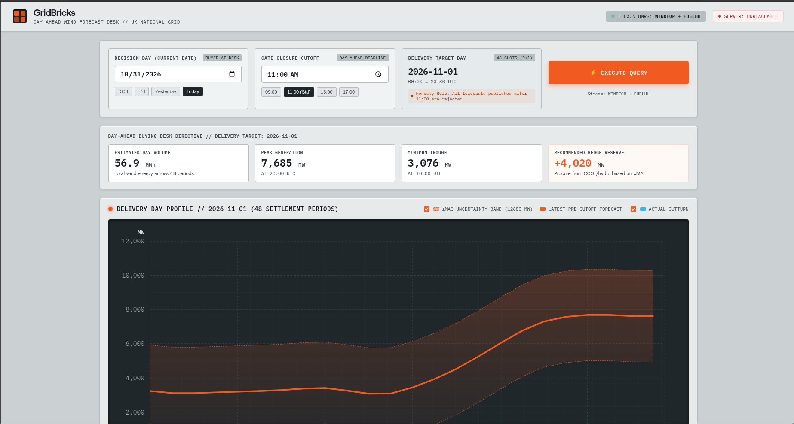
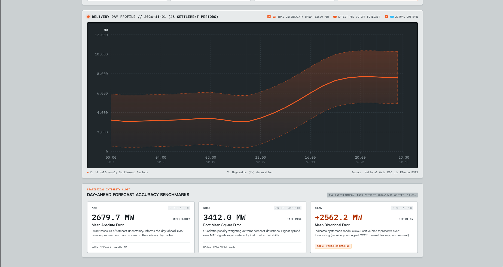
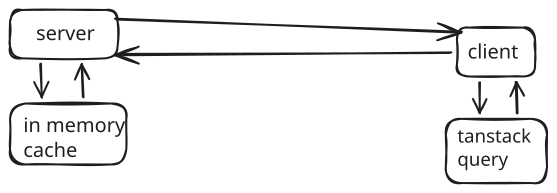

# Gridbricks

**Day-ahead wind power forecast desk** — a trading-floor-style dashboard for UK grid operators and energy buyers to evaluate WINDFOR forecasts against FUELHH actuals using live [Elexon BMRS](https://data.elexon.co.uk) data.



---

## What it does

Gridbricks simulates the workflow of a day-ahead energy buyer sitting at a trading desk. You pick a **decision date** and a **gate-closure cutoff time** (e.g. 11:00), and the app shows you what the best available wind forecast looked like at that moment — strictly honouring the cutoff so no future-leaked information is used. The delivery day is automatically set to D+1.

The **Honesty Rule** is the core invariant: only WINDFOR forecasts published *before* the cutoff time on the decision date are considered. Any forecast published after that point is rejected, mimicking real gate-closure constraints.

### Key features

- **48 half-hourly delivery slots** — the full D+1 settlement day visualised as a time-series chart
- **Forecast vs. actuals overlay** — WINDFOR predictions plotted against FUELHH outturn generation
- **MAE uncertainty band** — grey confidence envelope around the forecast line based on historical error
- **Error metrics panel** — rolling 30-day MAE, RMSE, and bias computed from live historical data
- **Procurement summary** — headline stats (peak MW, min MW, average, total GWh) for the buying team
- **Diagnostics modal** — backend health, ping latency, and CORS status



---

## Architecture

```
┌──────────────┐   HTTP/REST    ┌──────────────────────────────────────────┐
│   React UI   │ ◄────────────► │  FastAPI server                          │
│  (Vite/TS)   │                │                                          │
└──────────────┘                │  /api/forecasts/range  → WINDFOR stream  │
                                │  /api/actuals/         → FUELHH stream   │
                                │  /api/analytics/       → error metrics   │
                                │                                          │
                                │  In-memory cache (10 min TTL)            │
                                └──────────────────────┬───────────────────┘
                                                       │ httpx
                                                       ▼
                                            Elexon BMRS API
                                       data.elexon.co.uk/bmrs/api/v1
```



---

## Tech stack

| Layer | Technology |
|---|---|
| Frontend | React 19, TypeScript, Vite |
| Backend | Python 3.14, FastAPI, httpx |
| Data source | Elexon BMRS REST API (WINDFOR, FUELHH datasets) |
| Deployment | Docker Compose / Vercel |

---

## Getting started

### Prerequisites

- [Bun](https://bun.sh) or Node.js 18+ (for the client)
- Python 3.14+ with [uv](https://docs.astral.sh/uv/) (for the server)

### 1. Clone

```bash
git clone https://github.com/yourname/gridbricks
cd gridbricks
```

### 2. Start the server

```bash
cd server
uv sync
uv run uvicorn main:app --reload --port 8000
```

The API will be available at `http://localhost:8000`.

### 3. Start the client

```bash
cd client
bun install
bun run dev
```

Open `http://localhost:3000`.

> The Vite dev server proxies `/api` → `http://localhost:8000`, so no CORS setup is needed during local development.

---

## Docker Compose

To run the full stack with a single command:

```bash
docker compose up --build
```

- Client → `http://localhost:80`
- Server → `http://localhost:8000`

---

## API reference

All endpoints live under `/api`.

### `GET /api/forecasts/range`

Fetches raw WINDFOR wind power forecast data.

| Parameter | Type | Description |
|---|---|---|
| `date_from` | ISO datetime | Publish time range start |
| `date_to` | ISO datetime | Publish time range end |

### `GET /api/forecasts/latest`

Returns all WINDFOR forecasts published before a cutoff time on today's date.

| Parameter | Type | Default | Description |
|---|---|---|---|
| `cutoff_time` | `HH:MM:SS` | `11:00:00` | Gate closure time |

### `GET /api/actuals/`

Fetches FUELHH half-hourly generation outturn.

| Parameter | Type | Default | Description |
|---|---|---|---|
| `date_from` | ISO datetime | — | Publish time range start |
| `date_to` | ISO datetime | — | Publish time range end |
| `fuel_type` | string | `WIND` | Fuel type filter |

### `GET /api/analytics/`

Computes MAE, RMSE, and bias over a historical window using the day-ahead cutoff rule.

| Parameter | Type | Default | Description |
|---|---|---|---|
| `date_from` | ISO datetime | — | Start of decision-date window |
| `date_to` | ISO datetime | — | End of decision-date window |
| `cutoff` | `HH:MM:SS` | `11:00:00` | Gate closure cutoff |

```jsonc
// Example response
{
  "data": {
    "mae": 312.4,
    "rmse": 418.7,
    "bias": -28.1
  }
}
```

### `GET /ping`

Health check — returns `{"message": "pong"}`.

---

## Project structure

```
gridbricks/
├── client/                  # Vite + React frontend
│   └── src/
│       ├── components/      # UI components
│       │   ├── ControlsBar.tsx
│       │   ├── ForecastChart.tsx
│       │   ├── MetricsPanel.tsx
│       │   ├── ProcurementSummary.tsx
│       │   ├── Navbar.tsx
│       │   └── DiagnosticsModal.tsx
│       ├── hooks/
│       │   └── useDataQuery.ts  # Lightweight query cache hook
│       ├── services/
│       │   └── api.ts           # API client + slot processing logic
│       └── types.ts
├── server/                  # FastAPI backend
│   ├── main.py
│   ├── routers/
│   │   ├── forecasts.py
│   │   ├── actuals.py
│   │   └── analytics.py
│   └── services/
│       ├── elexon.py        # Elexon BMRS API client
│       ├── analytics.py     # MAE/RMSE/bias computation
│       ├── cache.py         # In-memory TTL cache
│       └── http_client.py   # Shared httpx client
├── showcase/                # Screenshots and architecture diagram
├── compose.yaml             # Docker Compose
└── vercel.json              # Vercel deployment config
```

---

## Data sources

- **WINDFOR** — Elexon BMRS wind power forecast dataset. Published multiple times per day by National Grid ESO.
- **FUELHH** — Elexon BMRS half-hourly fuel-mix generation outturn. Updated every 30 minutes after each settlement period closes.

Both datasets are publicly available at `https://data.elexon.co.uk/bmrs/api/v1` with no authentication required.

---

## Deployment on Vercel

The `vercel.json` at the repo root configures a multi-service deployment:

- The **client** is deployed as a Vite static site with `VITE_API_URL` automatically bound to the server service URL.
- The **server** is deployed as a FastAPI service.
- URL rewrites route `/api/*` to the FastAPI service transparently.

```bash
vercel deploy
```
